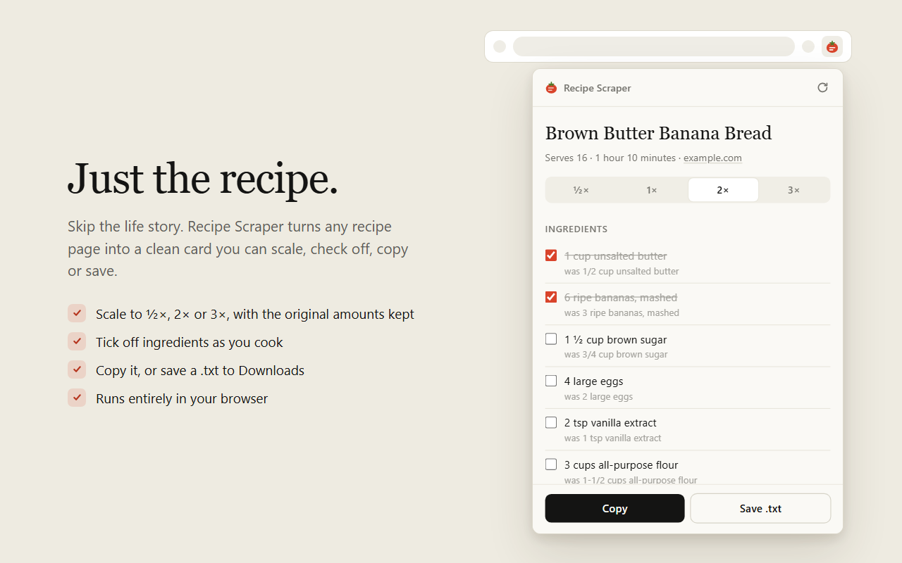

# Recipe Scraper

A Chrome and Edge extension that shows just the recipe: ingredients, steps, servings and time, without the life story, the ads or the endless scrolling.



## Features

- **Opens straight to the recipe.** The page is read as soon as you open the popup.
- **A clean recipe card.** Title, servings, time and a link back to the source, followed by ingredients and numbered steps.
- **Check off ingredients** as you cook. Ticks are kept when you change the size.
- **Scale to ½×, 2× or 3×.** The original amount is shown under each scaled one.
- **Choose between recipes** when a page has more than one.
- **Copy** the recipe as plain text, including the author, description and prep and cook times.
- **Save as .txt** to your downloads folder. The popup shows exactly where the file went.
- **Light and dark themes** that follow your system setting.
- **Works on most recipe sites.** It reads Schema.org recipe data and falls back to the page itself when that data is missing or incomplete.
- **Private.** Everything runs in your browser. Nothing is sent anywhere.

## Quick start

1. Open `chrome://extensions/` (or `edge://extensions/`).
2. Turn on **Developer mode** in the top-right corner.
3. Click **Load unpacked** and select the `browser-extension` folder from this repository.
4. Open a recipe page and click the Recipe Scraper icon. To read the page again, use the **Scan page again** button in the popup's header.
5. Pick a size if you want to scale the recipe, check off ingredients as you go, then click **Copy** or **Save .txt**.

Usage details, supported sites and troubleshooting are in [browser-extension/README.md](browser-extension/README.md).

## Repository layout

```
RecipeScraper/
├── README.md
├── package.json              Dev tooling only (test runner and jsdom); not shipped
├── test/
│   └── recipe.test.js        Tests for extraction, scaling and formatting
├── store-assets/             Chrome Web Store screenshots (1280x800, light and dark)
└── browser-extension/        The extension itself (load this folder unpacked)
    ├── manifest.json         Manifest V3 configuration
    ├── popup.html            Popup markup and styles
    ├── popup.js              Popup logic: runs the extraction, renders the card, scaling, copy and save
    ├── recipe.js             Extraction, scaling and text formatting, shared by the popup, the page and the tests
    ├── icon16.png            Toolbar icon
    ├── icon48.png            Extensions page icon
    ├── icon128.png           Store and install icon
    ├── icon.svg              Source for icon48 and icon128 (not shipped)
    ├── icon16.svg            Pixel-aligned source for icon16 (not shipped)
    ├── PUBLISHING.md         Packaging and Chrome Web Store notes
    └── README.md             Usage and troubleshooting
```

## Configuration

The extension uses Manifest V3. The current version is in `browser-extension/manifest.json`.

| Setting | Value |
| --- | --- |
| Permissions | `activeTab`, `scripting`, `downloads` |
| Popup | `popup.html` |
| Icons | `icon16.png`, `icon48.png`, `icon128.png` |
| Content scripts | None |
| Host permissions | None |

Why each permission is needed:

- `activeTab` lets the extension read the page you're on, and only after you open the popup.
- `scripting` runs `recipe.js` in that tab.
- `downloads` saves the `.txt` file to your downloads folder, reads back where it was saved, and opens that folder from **Show in folder**. There is no Save As dialog, because it would belong to the popup and closing the popup would cancel it.

## How it works

1. Opening the popup, or clicking **Scan page again**, looks up the active tab.
2. `popup.js` injects `recipe.js` into that tab with `chrome.scripting.executeScript` and calls `RecipeScraper.extractRecipes`, which returns the raw recipe data.
3. The popup formats and scales the recipe itself, using the same `recipe.js` loaded by `popup.html`.
4. **Save .txt** hands the text to `chrome.downloads` as a `data:` URL with `saveAs: false`, waits for the file to finish, then shows its full path.

Extraction works in three layers:

- **Schema.org JSON-LD.** Every distinct `Recipe` in the page's structured data is collected, wherever it sits (`@graph`, `mainEntity`, arrays, item lists).
- **Missing amounts.** Some sites list ingredient names without amounts in their structured data but show the amounts on the page. When a page has one recipe and the visible ingredient list has the same number of items with amounts, those lines are used instead.
- **HTML fallback.** For pages with no structured data, the extension looks for an ingredient list and an instructions list by class name. It handles ordinary lists as well as ingredients laid out as rows of elements, and it ignores hidden text such as a metric amount shown only on toggle. A page counts as a recipe only if it has at least 3 ingredients and 2 steps, so ordinary pages aren't mistaken for recipes.

## Development

```
npm install
npm test
```

The tests run the real `recipe.js` against small HTML pages using jsdom. For packaging a store release, see [browser-extension/PUBLISHING.md](browser-extension/PUBLISHING.md). Only the files the extension needs go in the zip.

## Notes

- Firefox is not supported, and there are no plans to add it.
- Never commit the extension's signing key (`*.pem`). It is git-ignored.
